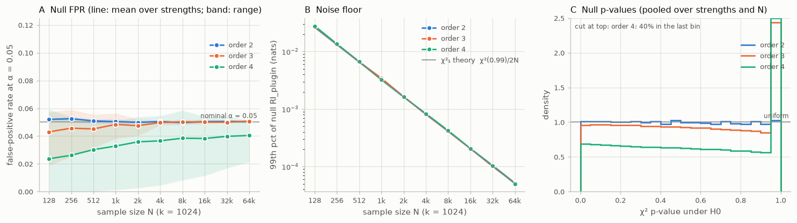
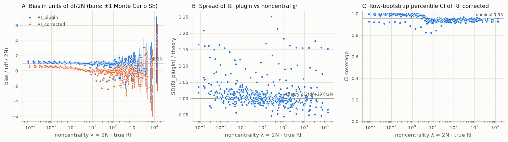
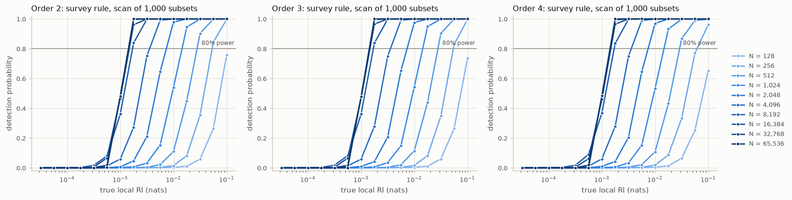
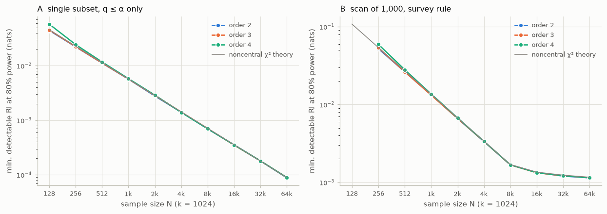
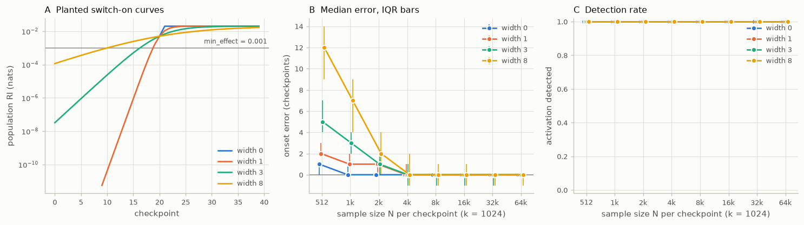
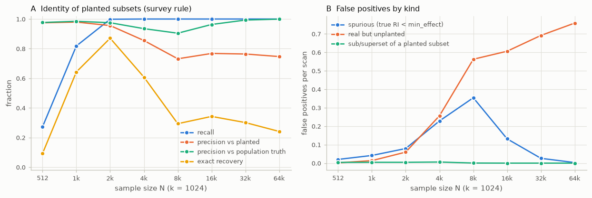
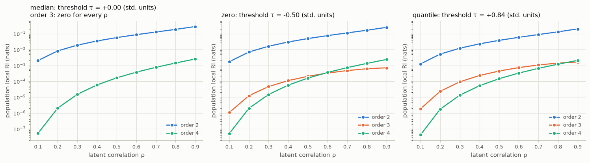
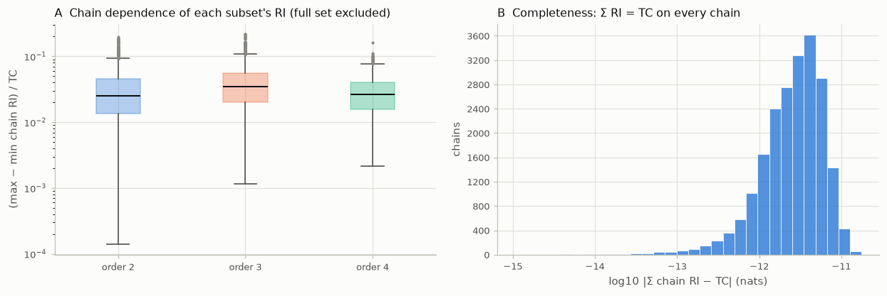

# Tycho instrument calibration

*Preset `full`, seed 0, run started 2026-11-09T15:58:24+00:00; wall time
8.12 min with 70 worker(s); 1,100 work
items, 1,094 of them reused from the cache of an earlier run, 0.594 CPU-hours
computed in this run. Source data: `results.json` and one CSV per experiment; machine-readable error budget:
`calibration.json`.*

## How to read this report

The survey's instrument is the **marginal refined information** RI(S) = RI^marg_S of a subset S of discrete
variables (Enouen & Sugiyama, TMLR 2026, Appendix C.1; called *local RI* in the code): the top-order term of the
S-marginal, `RI(S) = D(P_S ‖ (P_S)_∂S)`, in nats (`tycho/ri/refined.py`). It is 0 exactly
when the variables of S have no |S|-th-order interaction, and it equals the mutual information for |S| = 2. For
scale: log 2 = 0.693 nats is the RI of a perfect parity, and a pair of binary variables with correlation r has
RI ≈ r²/2 (so 1e-3 nats ≈ r = 0.045).

From N samples the instrument reports `RI_plugin` (RI of the empirical table), `RI_corr = max(0, RI_plugin −
df/2N)` (first-order bias correction; df = Π(k_i − 1), so df = 1 for binary variables), a p-value from
`G² = 2N·RI_plugin ~ χ²_df` and a Benjamini–Hochberg q-value across the subsets of a scan. A subset is
**detected** when `q ≤ α` *and* `RI_corr ≥ min_effect`. Here α = 0.01, and N = 4,096 (the survey's
default probe size) is used for the headline numbers.

Each experiment plants a known truth, observes it exactly as the survey would, and compares. All numbers are
Monte Carlo estimates; where a ± appears it is one standard error. "λ" denotes the noncentrality 2N·RI, the
quantity that asymptotic theory says governs both power and precision.

## Instrument error budget

| Quantity | Value | Source | How to read it |
|---|---|---|---|
| Noise floor: 99th pct of null RI_plugin (orders 2/3/4) | 8.1e-4 / 8.1e-4 / 8.3e-4 (χ² theory 8.1e-4) | E1 | An RI estimate below this is what pure sampling noise produces for 1 % of subsets with no interaction. It scales as 1/N. |
| Recommended min_effect (whole scan, N = 4,096) | 1.00e-3 | E1 + policy | max(policy floor 1.0e-3, 0.99 null quantile of RI_corr). The survey reads it from calibration.json. |
| False-positive rate at α = 0.01 (χ² p-value) | 0.92 % pooled; cells 0.0 %–1.3 % | E1 | Of 120 (cards, strength, N) cells, 7 have significantly more false alarms than α and 19 significantly fewer (conservative); exact one-sided binomial tests at 0.00135, the 3σ tail. |
| False-positive rate at α = 0.05 (χ² p-value) | 4.62 % pooled; cells 0.0 %–5.9 % | E1 | Of 120 (cards, strength, N) cells, 18 have significantly more false alarms than α and 19 significantly fewer (conservative); exact one-sided binomial tests at 0.00135, the 3σ tail. |
| Minimum detectable RI at 80% power (one targeted subset, q ≤ α) | 1.4e-3 / 1.4e-3 / 1.4e-3 (theory 1.4e-3) | E3 | Smallest true RI found 80 % of the time. Orders listed as in the noise-floor row. |
| Minimum detectable RI at 80% power (within a scan of 1,000 subsets, full survey rule) | 3.3e-3 / 3.3e-3 / 3.4e-3 (theory 3.4e-3) | E3 | Smallest true RI found 80 % of the time. Orders listed as in the noise-floor row. |
| Bias of RI_plugin, in units of df/2N (median over cells) | 0.998 | E2 | 1 means the plug-in overestimates by exactly the first-order term df/2N, which RI_corr removes. |
| Relative bias of RI_corr when λ ≥ 20 (worst cell) | 8.9 % | E2 | Worst |mean RI_corr − RI| / RI over cells with a clearly detectable interaction (λ = 2N·RI ≥ 20), Monte Carlo error included. |
| Bootstrap 95% CI coverage (median; λ ≥ 20 / λ < 20) | 94 % / 98 % | E2 | Fraction of row-bootstrap percentile intervals of RI_corr that contain the true RI (nominal 95%). |
| Onset timing error, median [IQR] in checkpoints (N = 4,096) | width 0: 0 [0, 0]; width 1: 0 [0, 1]; width 3: 0 [-1, 1]; width 8: 0 [-1, 2] | E4 | Detected minus true onset. Positive = reported late. The true onset is where the population RI first reaches min_effect. |
| Identity of planted subsets, recall / precision (N = 4,096) | 100 % / 85 % vs planted, 93 % vs population truth | E5 | 0.485 unplanted detections per 154-subset scan on average; the population truth counts every subset whose true RI ≥ min_effect. |
| Discretisation artefact, order-3 / order-4 RI at ρ = 0.5 | median: 0 / 1.6e-4; zero: 2.1e-4 / 1.6e-4; quantile: 4.4e-4 / 1.5e-4 | E6 | Interactions created by thresholding a purely pairwise Gaussian latent. They are real properties of the bits, but not of the latent. |
| Chain dependence: median (max − min)/TC of a subset's chain RI, by order | order 2: 2.5 %; order 3: 3.5 %; order 4: 2.6 % | E7 | How much one subset's chain RI moves when the order of incomparable subsets changes. Local RI has no such dependence. |
| Completeness |Σ chain RI − TC| (worst chain) | 1.8e-11 | E7 | Numerical error of the complete decomposition (exact in theory). |

### Noise floor: 99th percentile of null RI_plugin (nats)

Maximum over the three strengths of lower-order structure. Read: the value of RI_plugin that only 1 % of truly interaction-free subsets exceed at that N (before any multiple-testing correction).

|  | N = 128 | N = 256 | N = 512 | N = 1,024 | N = 2,048 | N = 4,096 | N = 8,192 | N = 16,384 | N = 32,768 | N = 65,536 |
|---|---|---|---|---|---|---|---|---|---|---|
| order 2 | 0.027 | 0.013 | 6.6e-3 | 3.3e-3 | 1.6e-3 | 8.1e-4 | 4.2e-4 | 2.1e-4 | 1.0e-4 | 5.2e-5 |
| order 3 | 0.027 | 0.013 | 6.6e-3 | 3.4e-3 | 1.6e-3 | 8.1e-4 | 4.1e-4 | 2.1e-4 | 1.0e-4 | 5.1e-5 |
| order 4 | 0.028 | 0.014 | 6.6e-3 | 3.2e-3 | 1.6e-3 | 8.3e-4 | 4.2e-4 | 2.1e-4 | 1.0e-4 | 5.0e-5 |
| χ²₁ theory | 0.026 | 0.013 | 6.5e-3 | 3.2e-3 | 1.6e-3 | 8.1e-4 | 4.0e-4 | 2.0e-4 | 1.0e-4 | 5.1e-5 |

### Recommended min_effect (nats)

`max(1.0e-3, Q_0.99(RI_corr | H0))`. The floor is a policy choice (effects weaker than it are not scientifically interesting); the quantile term is the measured noise floor and dominates at small N. Source of the quantile: E1 simulations.

|  | N = 128 | N = 256 | N = 512 | N = 1,024 | N = 2,048 | N = 4,096 | N = 8,192 | N = 16,384 | N = 32,768 | N = 65,536 |
|---|---|---|---|---|---|---|---|---|---|---|
| order 2 | 0.023 | 0.011 | 5.7e-3 | 2.8e-3 | 1.4e-3 | 1.0e-3 | 1.0e-3 | 1.0e-3 | 1.0e-3 | 1.0e-3 |
| order 3 | 0.023 | 0.011 | 5.7e-3 | 2.9e-3 | 1.4e-3 | 1.0e-3 | 1.0e-3 | 1.0e-3 | 1.0e-3 | 1.0e-3 |
| order 4 | 0.024 | 0.012 | 5.7e-3 | 2.7e-3 | 1.4e-3 | 1.0e-3 | 1.0e-3 | 1.0e-3 | 1.0e-3 | 1.0e-3 |
| **whole scan (max)** | **0.024** | **0.012** | **5.7e-3** | **2.9e-3** | **1.4e-3** | **1.0e-3** | **1.0e-3** | **1.0e-3** | **1.0e-3** | **1.0e-3** |

### Minimum detectable RI at 80% power (nats): a single targeted subset, q ≤ α only

"≤ x": already detected at the smallest planted RI x; "> max": not reached at the largest. Theory: noncentral χ²₁ with λ = 2N·RI (Bonferroni α/m for the scan).

|  | N = 128 | N = 256 | N = 512 | N = 1,024 | N = 2,048 | N = 4,096 | N = 8,192 | N = 16,384 | N = 32,768 | N = 65,536 |
|---|---|---|---|---|---|---|---|---|---|---|
| order 2 | 0.044 | 0.022 | 0.011 | 5.7e-3 | 2.8e-3 | 1.4e-3 | 7.0e-4 | 3.5e-4 | 1.8e-4 | 8.8e-5 |
| order 3 | 0.045 | 0.022 | 0.011 | 5.7e-3 | 2.8e-3 | 1.4e-3 | 7.0e-4 | 3.5e-4 | 1.8e-4 | 8.9e-5 |
| order 4 | 0.058 | 0.024 | 0.012 | 5.8e-3 | 2.9e-3 | 1.4e-3 | 7.0e-4 | 3.5e-4 | 1.8e-4 | 8.9e-5 |
| noncentral χ² theory | 0.046 | 0.023 | 0.011 | 5.7e-3 | 2.9e-3 | 1.4e-3 | 7.1e-4 | 3.6e-4 | 1.8e-4 | 8.9e-5 |

### Minimum detectable RI at 80% power (nats): a subset inside a scan of 1,000 subsets, q ≤ α and RI_corr ≥ recommended min_effect

"≤ x": already detected at the smallest planted RI x; "> max": not reached at the largest. Theory: noncentral χ²₁ with λ = 2N·RI (Bonferroni α/m for the scan).

|  | N = 128 | N = 256 | N = 512 | N = 1,024 | N = 2,048 | N = 4,096 | N = 8,192 | N = 16,384 | N = 32,768 | N = 65,536 |
|---|---|---|---|---|---|---|---|---|---|---|
| order 2 | > max | 0.052 | 0.026 | 0.013 | 6.6e-3 | 3.3e-3 | 1.7e-3 | 1.3e-3 | 1.2e-3 | 1.1e-3 |
| order 3 | > max | 0.054 | 0.026 | 0.013 | 6.6e-3 | 3.3e-3 | 1.7e-3 | 1.3e-3 | 1.2e-3 | 1.1e-3 |
| order 4 | > max | 0.059 | 0.028 | 0.014 | 6.7e-3 | 3.4e-3 | 1.7e-3 | 1.3e-3 | 1.2e-3 | 1.1e-3 |
| noncentral χ² theory | 0.11 | 0.054 | 0.027 | 0.014 | 6.8e-3 | 3.4e-3 | 1.7e-3 | 1.4e-3 | 1.2e-3 | 1.2e-3 |

### Onset timing error (checkpoints): median [25th, 75th percentile] · detection rate

| ramp | N = 512 | N = 1,024 | N = 2,048 | N = 4,096 | N = 8,192 | N = 16,384 | N = 32,768 | N = 65,536 |
|---|---|---|---|---|---|---|---|---|
| width 0 | 1 [0, 1] · 100 % | 0 [0, 1] · 100 % | 0 [0, 0] · 100 % | 0 [0, 0] · 100 % | 0 [0, 0] · 100 % | 0 [0, 0] · 100 % | 0 [0, 0] · 100 % | 0 [0, 0] · 100 % |
| width 1 | 2 [2, 3] · 100 % | 1 [1, 2] · 100 % | 1 [0, 1] · 100 % | 0 [0, 1] · 100 % | 0 [0, 0.25] · 100 % | 0 [0, 0] · 100 % | 0 [0, 0] · 100 % | 0 [0, 0] · 100 % |
| width 3 | 5 [4, 7] · 100 % | 3 [2, 4] · 100 % | 1 [0, 2] · 100 % | 0 [-1, 1] · 100 % | 0 [-1, 0] · 100 % | 0 [-1, 0] · 100 % | 0 [-1, 0] · 100 % | 0 [0, 0] · 100 % |
| width 8 | 12 [9, 14] · 100 % | 7 [4, 9] · 100 % | 2 [0, 4] · 100 % | 0 [-1, 2] · 100 % | 0 [-1, 1] · 100 % | 0 [-1, 1] · 100 % | 0 [-1, 0] · 100 % | 0 [-1, 0] · 100 % |

### Discretisation artefacts: population local RI of the thresholded bits (nats)

Order 2 is the genuine pairwise dependence of the latent; every order ≥ 3 value is created by thresholding. 0* = zero to machine precision (|RI| < 1e-12).

| binarisation | order | ρ = 0 | ρ = 0.1 | ρ = 0.2 | ρ = 0.3 | ρ = 0.4 | ρ = 0.5 | ρ = 0.6 | ρ = 0.7 | ρ = 0.8 | ρ = 0.9 |
|---|---|---|---|---|---|---|---|---|---|---|---|
| median | 2 | 0* | 2.0e-3 | 8.2e-3 | 0.019 | 0.035 | 0.057 | 0.086 | 0.13 | 0.19 | 0.28 |
| median | 3 | 0* | 0* | 0* | 0* | 0* | 0* | 0* | 0* | 0* | 0* |
| median | 4 | 0* | 5.3e-8 | 2.0e-6 | 1.5e-5 | 5.9e-5 | 1.6e-4 | 3.8e-4 | 7.6e-4 | 1.4e-3 | 2.5e-3 |
| zero | 2 | 0* | 1.7e-3 | 7.0e-3 | 0.016 | 0.03 | 0.049 | 0.076 | 0.11 | 0.16 | 0.25 |
| zero | 3 | 0* | 1.1e-6 | 1.2e-5 | 4.7e-5 | 1.1e-4 | 2.1e-4 | 3.3e-4 | 4.7e-4 | 6.2e-4 | 7.1e-4 |
| zero | 4 | 0* | 5.1e-8 | 2.0e-6 | 1.5e-5 | 5.7e-5 | 1.6e-4 | 3.6e-4 | 7.3e-4 | 1.3e-3 | 2.4e-3 |
| quantile | 2 | 0* | 1.2e-3 | 5.2e-3 | 0.012 | 0.023 | 0.038 | 0.059 | 0.088 | 0.13 | 0.2 |
| quantile | 3 | 0* | 1.9e-6 | 2.3e-5 | 9.3e-5 | 2.3e-4 | 4.4e-4 | 7.3e-4 | 1.1e-3 | 1.4e-3 | 1.6e-3 |
| quantile | 4 | 0* | 4.2e-8 | 1.8e-6 | 1.3e-5 | 5.3e-5 | 1.5e-4 | 3.3e-4 | 6.6e-4 | 1.2e-3 | 2.1e-3 |

### Chain dependence of chain RI

| order | median spread/TC | 90th pct | max | median spread/mean RI | median range of the order's share of TC |
|---|---|---|---|---|---|
| 2 | 2.5 % | 7.1 % | 19.6 % | 80 % | 4.9 % |
| 3 | 3.5 % | 8.0 % | 21.6 % | 111 % | 6.2 % |
| 4 | 2.6 % | 5.8 % | 16.4 % | 115 % | 4.6 % |

## E1 Null: false-positive rate and noise floor

**Question.** When a subset has *no* top-order interaction, how often does the instrument claim one, and how large
are the RI values that pure sampling noise produces?

**Design.** Tables over exactly k variables whose log-probability has only terms of order < k (random spin couplings
of scale "strength" ∈ {0, 0.5, 1}), so the true local RI of the k-set is
exactly 0. A fresh random table per replicate, 40,000 replicates per (k, strength, N); N ∈
{128, 256, 512, 1,024, 2,048, 4,096, 8,192, 16,384, 32,768, 65,536}. How concentrated the null tables are (median effective number of
cells, exp(entropy)): 2x2 at strength 0.5: 3.4 of 4; 2x2 at strength 1: 2.6 of 4; 2x2x2 at strength 0.5: 5 of 8; 2x2x2 at strength 1: 2.7 of 8; 2x2x2x2 at strength 0.5: 6 of 16; 2x2x2x2 at strength 1: 2.5 of 16; 3x3 at strength 0.5: 7.9 of 9; 3x3 at strength 1: 6 of 9. The largest strength is a deliberately harsh case.

**Result.**

* α = 0.01: pooled FPR 0.92 % over 120 cells (range 0.0 %–1.3 %). Cells with significantly too many false alarms (exact binomial test, one-sided 0.00135, the 3σ tail): 7; significantly too few (conservative): 19. Highest cell: cards 2x2x2, strength 0.5, N = 1,024: 1.28 % ± 0.05 %.
* α = 0.05: pooled FPR 4.62 % over 120 cells (range 0.0 %–5.9 %). Cells with significantly too many false alarms (exact binomial test, one-sided 0.00135, the 3σ tail): 18; significantly too few (conservative): 19. Highest cell: cards 2x2x2x2, strength 0, N = 128: 5.92 % ± 0.11 %.
* **Boundary cells** (24 of 120): more than 5 % of the replicates have RI_plugin = 0 exactly, up to 100 % (cards 2x2x2x2, strength 1, N = 128). There the sample has an empty cell in both parity classes of the top-order contrast, so the empirical table lies in the closure of the lower-order model and p = 1. Such a cell cannot produce a false positive, but it is also blind: a real interaction of the same order would be missed. It happens when strong lower-order structure concentrates the table on few cells, and it fades as N grows.
* Outside boundary cells: Kolmogorov–Smirnov distance of the χ² p-values from U(0, 1) at most
  0.043 (median over all cells 0.00655); mean of G²/df (theory 1) between
  0.987 and 1.1.

**Parametric-bootstrap null** (first 4,000 replicates of every cell, 999 draws each, same data as χ²): pooled FPR 0.91 % at α = 0.01 (0 liberal cells), 4.51 % at α = 0.05 (0 liberal cells). Its p-values live on the grid (1 + j)/(n_null + 1), which limits the resolution near small α.

**Categorical check** (cards 3x3, df = 4): FPR at α = 0.05 ranges 4.8 %–5.9 %, and the 99th percentile of RI_plugin follows χ²_df(0.99)/2N (`ri_plugin_q99` vs `theory_q99` in `E1_null.csv`).

**How to read.** Panel A is the calibration of the p-value: the lines should sit on the nominal α (a band reaching
far below α comes from boundary cells). Panel B is the noise floor: because G² = 2N·RI_plugin is χ²-distributed,
the floor falls as 1/N and is (for binary variables, df = 1) the same for every order. Higher orders are not
noisier per subset; they are costlier because there are many more candidate subsets (multiplicity, see E3), and
because sparse tables (boundary cells) appear at larger N. Panel C should be flat; a bar at p = 1 is the boundary
point mass.

## E2 Bias, RMSE and CI coverage

**Question.** When an interaction of known size is present, how accurate is the reported RI, and can its
bootstrap confidence interval be trusted?

**Design.** For each order k and each target true RI ∈ {3.2e-5, 5.6e-5, 1.0e-4, 1.8e-4, 3.2e-4, 5.6e-4, 1.0e-3, 1.8e-3, 3.2e-3, 5.6e-3, 0.01, 0.018, 0.032, 0.056, 0.1} nats: a fresh
random lower-order background (spin scale 0.2) per replicate, and the top-order coupling solved
so that the population local RI equals the target exactly. 8,000 replicates per cell; the first
500 also get a row-bootstrap 95% percentile CI (200 resamples).

**Result.** Median plug-in bias = 0.998 × df/2N (theory: 1). Median SD of RI_plugin =
1 × the noncentral-χ² prediction √(2(df + 2λ))/2N. Once λ = 2N·RI ≥ 20, the worst
relative bias of RI_corr is 8.9 %. CI coverage: median
94 % for λ ≥ 20 (range 89 %–97 %)
and 98 % for λ < 20 (range 82 %–100 %).

At N = 4,096:

| order | true RI | bias plug-in | bias corrected | RMSE corrected | RMSE / RI | CI coverage |
|---|---|---|---|---|---|---|
| 2 | 3.2e-5 | 1.2e-4 | 5.4e-5 | 1.9e-4 | 605 % | 99 % |
| 2 | 5.6e-5 | 1.2e-4 | 4.7e-5 | 2.1e-4 | 380 % | 99 % |
| 2 | 1.0e-4 | 1.2e-4 | 3.8e-5 | 2.6e-4 | 256 % | 99 % |
| 2 | 1.8e-4 | 1.2e-4 | 3.3e-5 | 3.2e-4 | 179 % | 99 % |
| 2 | 3.2e-4 | 1.2e-4 | 2.2e-5 | 4.1e-4 | 131 % | 98 % |
| 2 | 5.6e-4 | 1.3e-4 | 1.8e-5 | 5.6e-4 | 99 % | 93 % |
| 2 | 1.0e-3 | 1.2e-4 | -8.0e-7 | 7.2e-4 | 72 % | 92 % |
| 2 | 1.8e-3 | 1.2e-4 | 7.6e-7 | 9.5e-4 | 54 % | 93 % |
| 2 | 3.2e-3 | 1.3e-4 | 4.6e-6 | 1.2e-3 | 39 % | 94 % |
| 2 | 5.6e-3 | 1.4e-4 | 1.5e-5 | 1.7e-3 | 30 % | 94 % |
| 2 | 1.0e-2 | 1.1e-4 | -1.5e-5 | 2.2e-3 | 22 % | 94 % |
| 2 | 0.018 | 5.6e-5 | -6.6e-5 | 2.9e-3 | 16 % | 94 % |
| 2 | 0.032 | 9.2e-5 | -3.0e-5 | 3.8e-3 | 12 % | 94 % |
| 2 | 0.056 | 1.5e-4 | 3.3e-5 | 5.1e-3 | 9 % | 94 % |
| 2 | 0.1 | 1.8e-4 | 5.9e-5 | 6.7e-3 | 7 % | 94 % |
| 3 | 3.2e-5 | 1.2e-4 | 5.5e-5 | 2.0e-4 | 624 % | 99 % |
| 3 | 5.6e-5 | 1.2e-4 | 4.6e-5 | 2.1e-4 | 373 % | 100 % |
| 3 | 1.0e-4 | 1.2e-4 | 4.3e-5 | 2.6e-4 | 256 % | 98 % |
| 3 | 1.8e-4 | 1.2e-4 | 3.2e-5 | 3.2e-4 | 181 % | 99 % |
| 3 | 3.2e-4 | 1.1e-4 | 1.3e-5 | 4.1e-4 | 130 % | 98 % |
| 3 | 5.6e-4 | 1.2e-4 | 8.4e-6 | 5.5e-4 | 98 % | 95 % |
| 3 | 1.0e-3 | 1.1e-4 | -1.1e-5 | 7.1e-4 | 71 % | 92 % |
| 3 | 1.8e-3 | 1.3e-4 | 6.4e-6 | 9.6e-4 | 54 % | 93 % |
| 3 | 3.2e-3 | 1.2e-4 | 2.7e-6 | 1.3e-3 | 40 % | 95 % |
| 3 | 5.6e-3 | 1.3e-4 | 4.7e-6 | 1.6e-3 | 29 % | 95 % |
| 3 | 1.0e-2 | 1.2e-4 | 2.6e-7 | 2.2e-3 | 22 % | 94 % |
| 3 | 0.018 | 1.5e-4 | 2.7e-5 | 2.9e-3 | 16 % | 94 % |
| 3 | 0.032 | 1.4e-4 | 2.1e-5 | 3.9e-3 | 12 % | 95 % |
| 3 | 0.056 | 6.5e-5 | -5.7e-5 | 5.2e-3 | 9 % | 94 % |
| 3 | 0.1 | 9.3e-5 | -2.9e-5 | 6.7e-3 | 7 % | 94 % |
| 4 | 3.2e-5 | 1.2e-4 | 5.5e-5 | 2.0e-4 | 627 % | 99 % |
| 4 | 5.6e-5 | 1.2e-4 | 4.7e-5 | 2.1e-4 | 375 % | 99 % |
| 4 | 1.0e-4 | 1.2e-4 | 4.4e-5 | 2.6e-4 | 260 % | 99 % |
| 4 | 1.8e-4 | 1.3e-4 | 3.6e-5 | 3.2e-4 | 180 % | 98 % |
| 4 | 3.2e-4 | 1.2e-4 | 2.0e-5 | 4.1e-4 | 130 % | 98 % |
| 4 | 5.6e-4 | 1.1e-4 | 1.7e-6 | 5.4e-4 | 95 % | 95 % |
| 4 | 1.0e-3 | 1.2e-4 | 2.9e-6 | 7.1e-4 | 71 % | 94 % |
| 4 | 1.8e-3 | 1.3e-4 | 5.3e-6 | 9.5e-4 | 53 % | 92 % |
| 4 | 3.2e-3 | 1.3e-4 | 1.1e-5 | 1.3e-3 | 40 % | 92 % |
| 4 | 5.6e-3 | 1.2e-4 | -4.4e-6 | 1.7e-3 | 30 % | 92 % |
| 4 | 1.0e-2 | 5.5e-5 | -6.7e-5 | 2.2e-3 | 22 % | 95 % |
| 4 | 0.018 | 1.3e-4 | 7.2e-6 | 3.0e-3 | 17 % | 95 % |
| 4 | 0.032 | -3.7e-5 | -1.6e-4 | 4.1e-3 | 13 % | 94 % |
| 4 | 0.056 | 5.7e-6 | -1.2e-4 | 5.8e-3 | 10 % | 94 % |
| 4 | 0.1 | -7.8e-5 | -2.0e-4 | 8.1e-3 | 8 % | 95 % |

**How to read.** Asymptotic theory predicts that, plotted against λ, all orders and sample sizes collapse onto one
curve: the plug-in estimate is high by df/2N (panel A, blue points at 1) and the corrected estimate removes that
(orange points at 0), except at small λ, where the truncation max(0, ·) biases RI_corr upward. The error bars are
the Monte Carlo standard errors; at large λ the sampling spread of RI dwarfs df/2N, so those points are noisy in
these units. Panel B compares the observed spread with the noncentral-χ² prediction (1 = agreement). Panel C: the
nominal coverage line is the target. Near RI = 0 the estimator sits on the boundary RI ≥ 0, where percentile
intervals have no coverage guarantee, so CIs are most meaningful for detected subsets.

## E3 Power and minimum detectable RI

**Question.** How large must an interaction be for the survey to see it?

**Design.** The replicates of E2. The planted subset is tested together with m − 1 interaction-free subsets
(m ∈ {1, 1,000}; their p-values are U(0, 1), the worst case for
Benjamini–Hochberg because nothing else is discovered), and detected when q ≤ α (rule "stat") or when also
RI_corr ≥ the recommended min_effect (rule "survey"). The minimum detectable RI (MDE) is where the power curve
(made monotone by isotonic regression) crosses 80%, interpolated linearly in log RI and probit
power.

**Result.** Empirical MDE / theory: median 0.987 (range
0.968–1.28) over uncensored cells. Power is monotone in N:
65 of 1620 adjacent-N comparisons drop by more than 3 SE.
For df = 1 the theory says MDE ≈ λ*/(2N) with λ* = 11.7 (m = 1), 27.7 (m = 1000)
at α = 0.01.

**How to read.** Each curve in the first figure is the probability that a planted interaction of the given true RI
is detected, for one N. In the second figure the gray line is the theory: the statistical MDE falls as λ*/2N.
Under the survey rule it cannot fall below the min_effect floor, because then the effect-size filter rather than the
significance test decides; at large N more samples no longer lower the detection threshold, by design. Within a
scan of m subsets the multiplicity correction raises λ*, roughly in proportion to log m.

## E4 Timing of activation events

**Question.** When an interaction switches on during training, how accurately does the event detector date the
onset?

**Design.** A 3-way spin coupling θ(t) = θ_max·σ((t − t*)/width) over a fixed random lower-order
background, on 40 checkpoints (t* = 20; width 0 is a step), with θ_max set
so that the final population RI is 0.02 nats. At every checkpoint N fresh samples are scanned
(`ri_scan`, all subsets up to order 3), the scans form an `RICurve`, and `detect_events` runs with
on = min_effect = 1.0e-3, off = on/2 and persistence 2. The true onset is the first
checkpoint whose population RI ≥ min_effect. 1,000 replicates per (width, N).

**How to read.** Error = detected − true onset, in checkpoints (positive = late). The detector needs RI_corr ≥
min_effect *and* a significant q-value for 2 consecutive checkpoints. Expected pattern: at small
N the RI must first climb above the noise floor, so onsets are reported late, and more so for gradual ramps, whose
RI spends more checkpoints near the threshold; at large N the error shrinks toward 0, and negative errors (early
detections) appear when noise lifts an RI that is just below min_effect. The bracket [step_lo, step_hi] of an event
is one checkpoint wide; a replay with denser checkpoints narrows it.

## E5 Identity and specificity

**Question.** Does the instrument report the *right* subsets at the *right* order, and nothing else?

**Design.** d = 8 binary variables. Planted: {0,1,2} (order 3, θ = 0.15, true RI 0.011); {3,4} (order 2, θ = 0.15, true RI 0.011). A weak random background (spin scale
0.02) of biases on all variables and couplings on all other pairs; no background inside the
planted triple, which therefore stays a pure synergy. Full scan to order 4 (154
subsets, BH within the scan), 2,000 replicates per N. Rule "survey": q ≤ α and RI_corr ≥ the
recommended min_effect; rule "stat": q ≤ α only. Largest unplanted population RIs: {2,4} 1.1e-3, {0,7} 5.7e-4, {0,4} 4.8e-4
(1 unplanted subsets have RI ≥ min_effect = 1.0e-3).

**Result.**

| N | rule | recall | precision (planted) | precision (population) | exact recovery | FP / scan | spurious | real unplanted | related |
|---|---|---|---|---|---|---|---|---|---|
| 512 | survey | 27 % | 97 % | 98 % | 9 % | 0.0215 | 0.02 | 0.0015 | 0.004 |
| 1,024 | survey | 82 % | 98 % | 98 % | 64 % | 0.055 | 0.0415 | 0.0135 | 0.0045 |
| 2,048 | survey | 100 % | 96 % | 97 % | 87 % | 0.139 | 0.079 | 0.0595 | 0.0045 |
| 4,096 | survey | 100 % | 85 % | 93 % | 61 % | 0.485 | 0.229 | 0.257 | 0.006 |
| 8,192 | survey | 100 % | 73 % | 90 % | 29 % | 0.916 | 0.354 | 0.562 | 0.0005 |
| 16,384 | survey | 100 % | 77 % | 96 % | 34 % | 0.738 | 0.132 | 0.606 | 0 |
| 32,768 | survey | 100 % | 76 % | 99 % | 30 % | 0.718 | 0.026 | 0.692 | 0 |
| 65,536 | survey | 100 % | 75 % | 100 % | 24 % | 0.761 | 0.003 | 0.758 | 0 |
| 512 | stat | 27 % | 97 % | 98 % | 9 % | 0.0215 | 0.02 | 0.0015 | 0.004 |
| 1,024 | stat | 82 % | 98 % | 98 % | 64 % | 0.055 | 0.0415 | 0.0135 | 0.0045 |
| 2,048 | stat | 100 % | 96 % | 97 % | 87 % | 0.139 | 0.079 | 0.0595 | 0.0045 |
| 4,096 | stat | 100 % | 85 % | 93 % | 61 % | 0.485 | 0.229 | 0.257 | 0.006 |
| 8,192 | stat | 100 % | 59 % | 78 % | 10 % | 1.72 | 0.968 | 0.75 | 0.01 |
| 16,384 | stat | 100 % | 34 % | 50 % | 0 % | 4.27 | 3.28 | 0.995 | 0.014 |
| 32,768 | stat | 100 % | 21 % | 31 % | 0 % | 7.87 | 6.87 | 1 | 0.017 |
| 65,536 | stat | 100 % | 14 % | 21 % | 0 % | 12.2 | 11.2 | 1 | 0.0335 |

Most frequent false positives (survey rule): N = 512: {2,4} 0 %, {0,4} 0 %, {0,2,5} 0 %; N = 1,024: {2,4} 1 %, {0,7} 0 %, {0,4} 0 %; N = 2,048: {2,4} 6 %, {0,7} 2 %, {0,4} 1 %; N = 4,096: {2,4} 26 %, {0,7} 6 %, {0,4} 4 %; N = 8,192: {2,4} 56 %, {0,7} 13 %, {0,4} 8 %; N = 16,384: {2,4} 61 %, {0,7} 8 %, {0,4} 4 %; N = 32,768: {2,4} 69 %, {0,7} 2 %, {0,4} 0 %; N = 65,536: {2,4} 76 %, {0,7} 0 %.

**How to read.** Recall is the fraction of the two planted subsets found. Precision (planted) is the fraction of
detections that are planted; precision (population) is the fraction whose population RI is at least min_effect,
planted or not, which is the instrument's own precision (a detected real background interaction is not an
instrument error). "Spurious" false positives have population RI below min_effect; "related" ones are proper sub- or
supersets of a planted subset, i.e. errors of order rather than of identity. Inside the planted subsets the largest
population RI of a proper subset is 2.2e-6 nats (induced only by the weak biases), so the
3-way interaction must be found as a triple, without lower-order precursors; a detected {0,1} would be an order
error.

## E6 Discretisation artefacts (RQ0)

**Question.** RI needs discrete variables, so continuous activations are thresholded. How much higher-order
"interaction" does thresholding create by itself?

**Design.** An equicorrelated Gaussian latent (correlation ρ, purely pairwise structure) is binarised by the
median, by zero with latent mean 0.5 (a biased pre-activation; the bit is on with probability
Φ(0.5)), or at the 0.8 quantile. Exact population local RI by order from the
one-factor integral, plus sampled scans of 6 variables to order 4.

**Result.** **Median thresholding, sign symmetry: VERIFIED.** Largest |population RI| at odd orders: 1.8e-16 nats (zero to machine precision; tolerance 1e-12). Smallest even-order (≥ 4) RI over ρ > 0: 5.3e-8 nats. In the sampled scans at N = 65,536, the bias-corrected mean RI of order-3 subsets (mean RI_plugin − df/2N, first-order unbiased) is at most 2.5e-7 nats in absolute value, 2.14 SE from 0. (The mean of RI_corr itself is positive even at a true zero, because max(0, ·) truncates the noise.)

Largest order-3 RI by binarisation: median: 1.8e-16, zero: 7.1e-4, quantile: 1.6e-3 nats. At N = 65,536 the highest detection rate of an artefact (order ≥ 3) is 100.0 % of subsets (median, ρ = 0.9, order 4, population RI 2.5e-3).

**How to read.** This is a systematic error of the instrument, not a sampling error: more samples make it *more*
detectable, not less. The mechanism: thresholding a Gaussian is a nonlinear map, and the log-probabilities of the
resulting bits contain higher-order terms even though the latent has only pairwise couplings (the "dichotomized
Gaussian" of Amari et al. 2003 and Macke et al. 2009). With the threshold at the median the bit distribution is
invariant under flipping every bit, which forces every odd-order log-linear coefficient to zero; even orders
survive. Moving the threshold off the median breaks the symmetry and odd orders appear. Practical rule: for
binarised hidden units, treat order-3/4 events whose RI is comparable to these values (at the units' measured
correlations) as possible artefacts.

## E7 Chain dependence and completeness

**Question.** Chain RI (the complete decomposition of the KL error along a hierarchical chain) depends on the
order in which incomparable subsets enter the chain. How much?

**Design.** 400 random positive tables (cards 2×3×2×3, 3×2×2×2, 2×2×3×2×3, 2×3×2×2×2; log-potentials i.i.d. Normal(0,
1²) per cell, so interactions of every order are present). Chains: graded (graded-lex), reverse
graded (reverse lexicographic within each order), greedy (largest RI gain first: mode interaction selection) and
50 random admissible chains per table.

**Result.** Σ RI over every chain equals the total correlation to 1.8e-11 nats (worst case
over all chains and tables). By order, the median spread (max − min over chains) of a subset's chain RI is
2.5 % of TC (order 2), 3.5 % of TC (order 3), 2.6 % of TC (order 4); relative to
the subset's own mean chain RI the median spread is
80 % (order 2), 111 % (order 3), 115 % (order 4). The graded
chain's value differs from the chain-independent local RI by a median of
0.1 % of TC (order 2), 0.7 % of TC (order 3), 0.8 % of TC (order 4).
The full variable set is excluded from these statistics: it is the last step of every complete chain, so its chain
RI is the same in all of them (largest spread observed: 6.1e-16 nats).

**How to read.** Completeness (panel B) is a numerical identity check: the chain terms always add up to the total
correlation, whichever chain is used. The spread (panel A) is a property of the definition, not an estimation error:
the same subset can be credited with very different amounts of information depending on what entered the chain
before it. This is why the survey's events use the chain-independent local RI, and why every chain RI that is
reported must name its chain.

## Caveats and open items

* **Soft output columns are not calibrated here.** All experiments sample hard codes. The survey's positive controls
  enter the model's predictive distribution as a soft column, which removes that variable's sampling noise. For a
  subset whose table is fully determined by such a column the null is degenerate (RI_plugin = 0 exactly); in general
  `tycho/ri/estimators.py` states that the χ² null is then conservative. A soft-column null experiment is still to
  be done.
* **Independent samples.** Every experiment draws i.i.d. samples. Probe sets in the survey are i.i.d. by construction
  (fresh inputs per checkpoint); dependent samples (e.g. tokens of one sequence) would need an effective N.
* **Binary noise floor.** The (order, N) tables are for binary variables (df = 1). For categorical variables the
  floor scales with the χ²_df quantile (E1's categorical rows check df > 1).
* **RI convention.** The local RI and the chain RI follow `docs/SPEC.md` §2.1; the canonical chain of Enouen &
  Sugiyama (TMLR 2026) still has to be checked against the paper.
* **Monte Carlo error.** Quick runs exist to exercise the code; only a `full` run supports quantitative claims.
